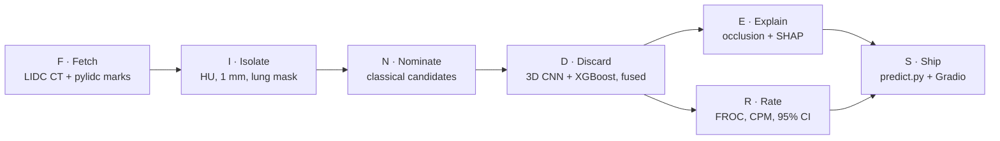

# Lung Nodule Detection: a Hybrid, Explainable 3D Pipeline on LIDC-IDRI

> **Status:** Phase 0 (setup) · started Sat 31 Oct 2026
> Every number marked **TBD** is measured in a later phase. **Nothing in this file is a result yet.**
> Research prototype, **not a medical device**.

---

## 0. Read this first (1 minute)

- **Goal:** find **lung nodules (≥ 3 mm)** anywhere in a **full chest CT scan**. For each one, say **where** it is, **how sure** we are, and **why** (a heat map).
- **Not the goal:** malignancy (cancer or not). That was **v2** (`2026-hybrid-nodule-v2`), a separate project kept as it is.
- **Data:** LIDC-IDRI **full CT scans** (DICOM) + **radiologist outlines** (read with `pylidc`).
- **Hybrid:**
  - **classical** image processing finds candidates → fast and rule-based
  - a **3D CNN** rejects false alarms → it sees 3D shape
  - a **feature model** (XGBoost) gives a second opinion
  - the two scores are **fused**
- **Explainable:**
  - every detection gets an **occlusion heat map**
  - the feature model gets **SHAP** bars
  - heat maps are **scored**, never just shown
- **Honest:** FROC + CPM with **95% CIs**, **test set opened once**, every baseline reported.

🖼 **Mental image: minesweeping.** A **metal detector** beeps at everything (candidates) → a **sniffer dog** checks each beep (3D CNN) → the team **photographs why** each spot was flagged (heat map).

---

## 1. The pipeline: **FINDERS**



| | Layer | What it does | Because | Output |
|:-:|---|---|---|---|
| **F** | Fetch | download CT scans with `idc-index` to `/scratch`; read radiologist marks with `pylidc` | public bucket, no login; the marks ship inside pylidc's local database | `lidc_raw/`, `nodules.csv` |
| **I** | Isolate | stored value → **HU** → **1 mm voxels** → **lung mask** | every scan must use the **same ruler**; nodules live **inside** the lungs | `cache/<series>.npz` |
| **N** | Nominate | threshold + connected blobs of 3–30 mm inside the mask | **high recall**, no training, every rule can be explained | `candidates.csv` |
| **D** | Discard | 3D CNN on **32 mm cubes** + XGBoost on candidate features, fused | a vessel and a nodule look alike in one slice but differ in **3D shape** | `scores.csv`, checkpoints |
| **E** | Explain | occlusion maps (CNN), SHAP (XGBoost), a random-weights sanity check | "why is this beep a nodule?" | `results/explain/` |
| **R** | Rate | FROC, CPM, bootstrap 95% CI, ablation table | one number **plus** its uncertainty | `results/` |
| **S** | Ship | `predict.py` (scan in → nodules out), Gradio app, docs | a demo and a defendable write-up | `app/`, `docs/` |

---

## 2. Ground truth: what counts as a nodule

- **LIDC-IDRI:** 1,010 patients, 1,018 CT scans, about **124 GB**. Up to **4 radiologists** read each scan.
- **Rule (same as LUNA16):**
  - keep scans with slice thickness **≤ 2.5 mm**
  - a **nodule** = **≥ 3 mm** and marked by **≥ 3 of 4** readers
  - LUNA16 got **888 scans / 1,186 nodules** with this rule → our Phase 1 count must land close (**gate**)
- **Ignore zones:** marks by only 1–2 readers, marks < 3 mm, and "non-nodules".
  - A detection there is **neither a hit nor a false alarm**, because the readers disagreed.
- **Hit** = detection centre within the **nodule's radius**. Two detections on one nodule count once.
- **Worked example:**
  - nodule centre at (120, 200, 85) mm, diameter 8 mm → radius **4 mm**
  - detection at (122, 201, 86) → distance √(2² + 1² + 1²) = √6 ≈ **2.45 mm**
  - 2.45 < 4 → **hit**
- ⚠ The labels are **radiologist marks**, not biopsy. The project finds what **3 of 4 readers agreed is a nodule**.

---

## 3. The score: FROC + CPM

- **FROC curve:** sensitivity (y) vs **false positives per scan** (x).
- **CPM** = mean sensitivity at **1/8, 1/4, 1/2, 1, 2, 4, 8** FP/scan.
- **Worked example (not a result):**
  - sensitivities 0.70, 0.78, 0.85, 0.90, 0.93, 0.95, 0.96
  - sum = 6.07 → 6.07 ÷ 7 = **CPM 0.867**
- **95% CI:**
  - resample the **test patients** 1,000 times and recompute CPM each time
  - the middle 95% of those values is the CI
  - we resample **patients**, not candidates, because candidates from one scan are not independent
- **Lesson from v2:** one training run moves by chance → every deep model is trained with **5 seeds**.

---

## 4. "Advanced ML": the staircase of rungs

Each rung must beat the one below it **on validation**. The **test set is opened once**, for the final rung only.

| Rung | System | Why it is there |
|:-:|---|---|
| **R0** | candidates ranked by a hand rule (size × density) | the floor: what you get with **no learning** |
| **R1** | + **XGBoost** on ~20 hand-made candidate features (size, sphericity, HU statistics, distance to the lung wall) | classical ML baseline, explainable with **SHAP** |
| **R2** | + **3D CNN** (3D ResNet-style) on 32 mm cubes | the deep model sees **3D shape** |
| **R3** | + **hard-negative mining**, **focal loss**, **3D augmentation**, **test-time flips** | the "advanced" training tricks, each one measured |
| **R4** | **hybrid fusion:** CNN score + XGBoost score (stacked logistic regression) + **5-seed ensemble** | does mixing help? **measured, not assumed** |
| *stretch* | end-to-end 3D detector (MONAI RetinaNet) trained on **our** split | a modern one-network comparison |

- **Class imbalance:** a scan gives about **TBD** candidates for about 1–2 real nodules.
  - So training uses **balanced batches** and **focal loss**, because plain accuracy would reward "everything is a false alarm".
- **No pretrained LUNA16 weights.** LUNA16 is built from LIDC, so those weights have already **seen our test scans** (leakage).

---

## 5. Design rules carried over from v2: **PRISM**

- **P**atient split → all scans of one patient go into one split, because shared patients **leak** and inflate scores.
- **R**esample to 1 mm → the same physical size in every scan.
- **I**nputs from pixels only → no radiologist ratings as inputs, because the readers also made the labels (**circular**).
- **S**eeds ×5 + 95% CI → **test set opened once**.
- **M**aps scored → **occlusion** first. In v2, layer4 Grad-CAM scored **worse than an untrained network**, so every heat map gets a **random-weights sanity check**.

---

## 6. Plan: phases and timeline (Sat 31 Oct → Sun 1 Nov 2026)

Each phase = **one git branch** + **one gate number** that must be verified + **notes in `docs/phases/PHASE_N.md`**.

| Phase | FINDERS | When | Builds | Gate (must be true to move on) | Branch |
|:-:|:-:|---|---|---|---|
| **0** · setup | — | Sat AM | repo, env (PyTorch on GPUs 1–3), **download running in tmux**, pylidc loads 1 scan | 1 scan + its nodules load; **download speed measured** | `phase-0-setup` |
| **1** · fetch + isolate | F, I | Sat midday | `nodules.csv`, **patient splits**, HU → 1 mm → lung mask cache | counts ≈ 888 / 1,186 (for the scans we have); air ≈ −1000 HU; **0 patients shared** | `phase-1-fetch-isolate` |
| **2** · nominate | N | Sat PM | classical candidates + **R0** | candidate **recall on validation** (target ≥ 90%, **TBD**) and FP/scan reported | `phase-2-nominate` |
| **3** · discard | D | Sat night → Sun AM | patch dataset, **R1–R4** trained overnight on GPUs 1–3 | validation CPM for every rung | `phase-3-discard` |
| **4** · explain + rate | E, R | Sun midday | occlusion + sanity check, SHAP, **test once**, CIs, failure gallery | every number reruns from one script | `phase-4-explain-rate` |
| **5** · ship | S | Sun evening | `predict.py`, **Gradio** app, final README, reality-check doc, PPT figures | a fresh scan → detections in **one command** | `phase-5-ship` |

**At every phase:**
- **Start:** a one-line **prediction** at the top of `PHASE_N.md`.
- **End:** notes **from memory**, checked against the code, plus the **git commands** to run.

**If the network is slow:**
- pylidc's **local** database picks the scans with the **most nodules first**, so a partial download is still useful.
- The stretch rung is dropped first.

---

## 7. How we work: Mac + GitHub + GPU server (**WRAP**)

| Where | Holds | Never holds |
|---|---|---|
| **Mac** (8 GB) | code, docs, tests on **fake** scans | CT data |
| **GitHub** | code + small results | data, checkpoints |
| **Server** `/scratch/mtech_shrinkhal/` | raw scans, cache, candidates, checkpoints, results | — |

- **W**rite → Claude writes code + CPU tests in this folder on the Mac; you run `pytest`.
- **R**elay → `git push` (Mac) → `git pull` (server).
- **A**ct → run on the server inside **tmux**, with `CUDA_VISIBLE_DEVICES=1,2,3` (GPU 0 is shared).
- **P**ull back → `rsync` the small `results/` to the Mac (checkpoints excluded).

**Server facts:**
- 4 × NVIDIA H200 NVL.
- `/home` is **full** → everything big goes to `/scratch` (2.7 TB free).
- Conda env **`lungxai`** (Python 3.11); PyTorch is installed or verified in Phase 0.
- `~/.bashrc` sends `TMPDIR`, the pip cache and the conda pkgs cache to `/scratch`.

---

## 8. Repository layout

Every folder has its own `README.md` saying what goes there and in which phase.

```text
2026-lung-nodule-detection/
├── README.md            ← you are here: goal, pipeline, plan
├── configs/             ← one YAML with every path and setting
├── scripts/             ← numbered steps you run on the server (00_ … 09_)
├── src/lungdet/         ← the library, one sub-folder per FINDERS layer
│   ├── common/          ← device (CUDA → MPS → CPU), paths, seeds, logging
│   ├── fetch/           ← F: idc-index download, pylidc ground truth
│   ├── isolate/         ← I: HU, resampling, lung mask
│   ├── nominate/        ← N: classical candidate finder
│   ├── discard/         ← D: patches, XGBoost, 3D CNN, fusion
│   ├── explain/         ← E: occlusion, SHAP, sanity checks
│   └── rate/            ← R: hit matching, FROC, CPM, bootstrap CI
├── app/                 ← S: Gradio demo
├── tests/               ← CPU tests on synthetic scans (run on the Mac)
├── docs/                ← plan, decisions, reality check
│   └── phases/          ← PHASE_0.md … PHASE_5.md (your notes)
├── results/             ← metrics + figures (checkpoints git-ignored)
└── data/                ← README only; real data lives on /scratch
```

---

## 9. Limits we already know (seeds for the reality-check doc)

1. **Labels are radiologist marks** (≥ 3 of 4 agree), not pathology, and only nodules ≥ 3 mm.
2. **One dataset**, no external hospital → our numbers mean "**on LIDC**", not "in clinics".
3. The **slice-thickness rule** drops thick-slice scans → the detector is untested on them.
4. **The candidate finder caps recall:** a nodule it misses can never be found by a later stage.
5. A **2-day build:** v1 numbers, no large hyperparameter search.

---

## 10. Glossary

- **HU (Hounsfield unit):** CT density scale. Air ≈ −1000, lung ≈ −800, water 0, bone ≥ +400. **Stored value × slope + intercept = HU.**
- **Voxel:** a 3D pixel. LIDC voxels are often 0.7 × 0.7 × 2.5 mm → we resample them to **1 × 1 × 1 mm**.
- **Candidate:** a spot that **might** be a nodule (from step N).
- **False positive (FP):** a candidate we call a nodule that isn't one.
- **Recall / sensitivity:** share of real nodules we find.
- **FROC / CPM:** see section 3.
- **Occlusion map:** cover one small cube at a time and watch the score drop → **where** the model looked.
- **SHAP:** how much each feature pushed one prediction up or down.

---

## 11. Data, licence, references

- **LIDC-IDRI data:** Armato SG III et al. (2015). *Data From LIDC-IDRI* [Data set]. The Cancer Imaging Archive. https://doi.org/10.7937/K9/TCIA.2015.LO9QL9SX (CC BY 3.0)
- **LIDC-IDRI paper:** Armato SG III et al., *Medical Physics* 38(2):915–931, 2011.
- **TCIA:** Clark K et al., *J Digit Imaging* 26(6):1045–1057, 2013.
- **Download tool:** NCI Imaging Data Commons, `idc-index` (Fedorov A et al.).
- **pylidc:** Hancock MC, Magnan JF, *J Med Imaging* 3(4):044504, 2016.
- **LUNA16:** Setio AAA et al., *Medical Image Analysis* 42:1–13, 2017.
- **Focal loss / RetinaNet:** Lin T-Y et al., ICCV 2017.
- **Occlusion sensitivity:** Zeiler MD, Fergus R, ECCV 2014.
- **SHAP:** Lundberg SM, Lee S-I, NeurIPS 2017.
- **Sanity checks for saliency maps:** Adebayo J et al., NeurIPS 2018.

## Credits

Built by **Shrinkhal**, with **Claude** (Anthropic) as a coding assistant.
