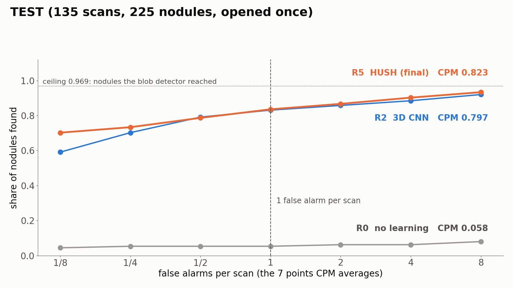
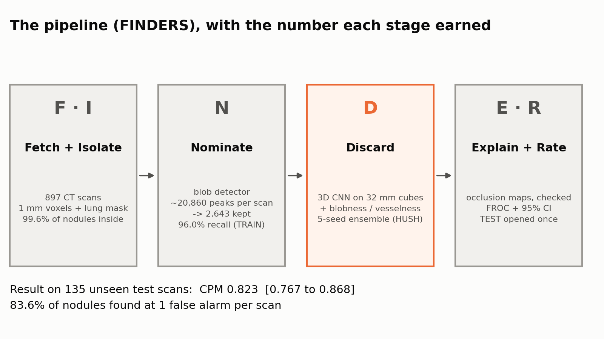
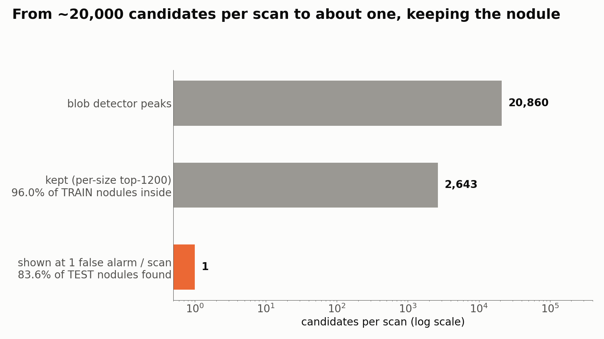
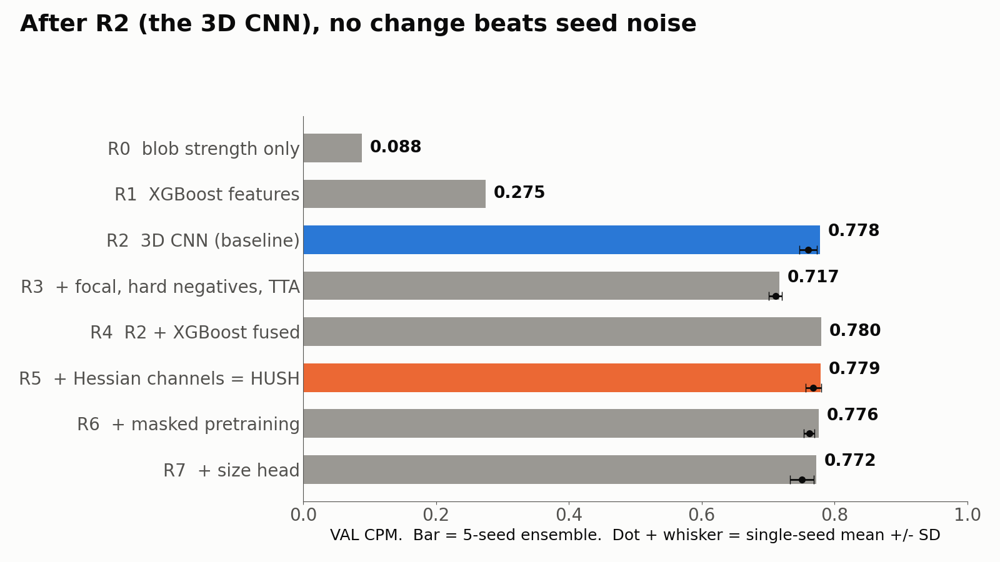
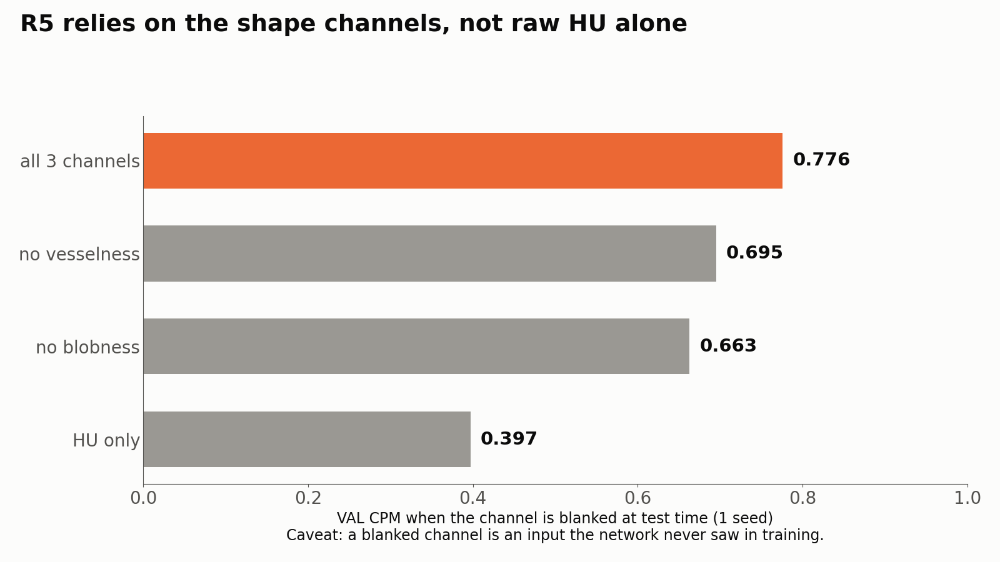
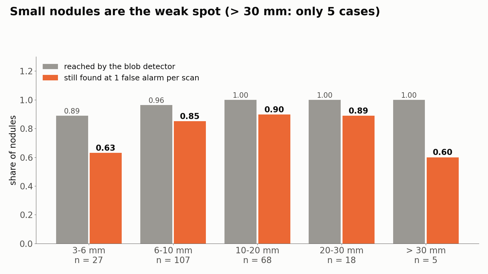

# Lung Nodule Detection: a Hybrid, Explainable 3D Pipeline on LIDC-IDRI

> **v1.0 · research prototype, not a medical device.** Finds what **3 of 4 radiologists agreed is a nodule (≥ 3 mm)** in a full chest CT. It says nothing about cancer.
> Every number below comes from a script in this repo; the evidence is in [`docs/REALITY_CHECK.md`](docs/REALITY_CHECK.md).

---

## 0. Result in 30 seconds

- **TEST CPM 0.823** (95% CI **0.767–0.868**) on **135 unseen scans / 225 nodules**, test set **opened once**.
- At **1 false alarm per scan** → **83.6%** of nodules found. At **4** → **90.2%**.
- **No learning (blob strength only): CPM 0.058** → the CNN is doing the work.
- **HUSH (R5) vs a plain 3D CNN (R2): +0.026, CI +0.001 to +0.078** → small, **weakly supported** (on VAL they tied).
- **Weak spot:** **3–6 mm** nodules → only **63%** found at 1 false alarm per scan (17 of 27).
- **Ceiling:** the blob detector reaches **96.9%** of nodules; no later stage can beat that.



| Model (TEST) | CPM | 95% CI | sens @ 1/8 FP | @ 1 FP | @ 4 FP |
|---|:-:|:-:|:-:|:-:|:-:|
| R0 · no learning | 0.058 | 0.031–0.094 | 0.044 | 0.053 | 0.062 |
| R2 · 3D CNN, 5 seeds | 0.797 | 0.725–0.847 | 0.591 | 0.831 | 0.884 |
| **R5 · HUSH, 5 seeds (shipped)** | **0.823** | **0.767–0.868** | **0.702** | **0.836** | **0.902** |

**CPM** = mean sensitivity at 1/8, 1/4, 1/2, 1, 2, 4, 8 false alarms per scan. **CI** = 1,000 bootstrap resamples of *scans* (not candidates, because candidates of one scan are not independent).

---

## 1. Quickstart (3 commands)

```bash
pip install -r requirements.txt                         # CPU is fine; add requirements-demo.txt for the Gradio app
# get the weights (14 MB x 5) from the GitHub Release into ./models/
gh release download v1.0 -p "lungdet-v1.0-hush-r5-weights.zip" && unzip lungdet-v1.0-hush-r5-weights.zip -d models
python predict.py /path/to/dicom_folder --fp-per-scan 1 --out out/     # -> out/findings.csv, findings.png, summary.json
```

- **Input:** a folder of DICOM slices (needs `pydicom`), or a cached `.npz` from `scripts/03_isolate.py`.
- **Output:** one row per finding (rank, probability, size estimate, voxel coordinates in the original scan) + a picture.
- **`--fp-per-scan`** picks the operating point (1/8 … 8). Thresholds are picked on **VAL**, never on TEST.
- **`--explain 3`** adds occlusion maps (where the model looked) for the top 3 findings.
- **Speed (measured):** one real scan (LIDC-IDRI-0405) on a **MacBook CPU (Apple Silicon, 8 GB)** took **2,578 s ≈ 43 min** with the full 5-model ensemble (2,522 candidates; 2,525 s of that was scoring, i.e. about 0.2 s per cube per model). A GPU should take seconds (not measured). `--models 1` is about 5× faster but **not the measured setup**.
- **Memory:** the lung mask uses distance transforms on the full 1 mm volume → plan **8–16 GB RAM** for a raw DICOM chest. A cached `.npz` (already isolated) needs far less.
- **Demo:** `pip install -r requirements-demo.txt && FORCE_CPU=1 python app/app.py`, open http://localhost:7860 and type the path of a `.npz` or DICOM folder (see [`app/README.md`](app/README.md)).

---

## 2. The pipeline: **FINDERS**



| | Layer | What it does | Because | Where |
|:-:|---|---|---|---|
| **F** | Fetch | LIDC-IDRI scans via `idc-index`; radiologist marks via `pylidc` | public bucket, no login | `scripts/01_fetch.py`, `02_ground_truth.py` |
| **I** | Isolate | HU → clip → **1 mm voxels** → **lung mask** (TRACE) → crop | one ruler for every scan; nodules live inside lungs | `scripts/03_isolate.py`, `isolate/` |
| **N** | Nominate | **LoG blob detector** at 7 sizes, per-size top-1,200 | balls beat vessels (tubes) and walls (sheets); high recall, no training | `scripts/04_nominate.py`, `nominate/` |
| **D** | Discard | **3D CNN** on 32 mm cubes with 3 channels [HU, **blobness**, **vesselness**]; **5-seed ensemble** | a vessel and a nodule look alike in one slice but differ in 3D shape | `scripts/06_train_cnn.py`, `discard/` |
| **E** | Explain | **occlusion maps**, scored, with a random-weights sanity check | "why is this beep a nodule?" | `scripts/11_explain.py`, `explain/` |
| **R** | Rate | FROC, CPM, bootstrap CI, size breakdown | a number **plus** its uncertainty | `scripts/10b_test_report.py`, `rate/` |
| **S** | Ship | `predict.py`, Gradio app, docs, figures | a demo and a defendable write-up | `predict.py`, `app/`, `src/lungdet/ship/` |

🖼 **Mental image: minesweeping.** A **metal detector** beeps at everything (20,860 peaks per scan → 2,643 kept) → a **sniffer dog** checks each beep (3D CNN) → the team **photographs why** (occlusion map).



---

## 3. What was tried (the staircase)

Each rung changes **one thing** and must beat the rung below by **more than the seed-to-seed spread**.



- **R1 XGBoost** on hand-made features: **0.275** → far below a CNN.
- **R2 3D CNN: 0.778** (single seeds 0.760 ± 0.013) → the big jump.
- **R3** focal loss + hard negatives + rot90 + TTA bundled together: **0.717** → **worse**, because bundled tricks hide which one hurt.
- **R4** fuse R2 with XGBoost: 0.780 → a **tie**.
- **R5 HUSH** = R2 + **H**essian shape channels: **0.779**, **R6** + **U** masked-cube pretraining: 0.776, **R7** + **S** size head: 0.772 → none above seed noise on VAL.
- **R5 was shipped** because it ties R2 on VAL, scored higher on TEST (weakly), and is **explainable through its channels**. That is a choice, not a proven win.
- **Ablation (R5, 1 seed, VAL):** blank blobness → **0.663**, blank vesselness → 0.695, HU only → **0.397** → the network leans on the shape channels.



---

## 4. Where it fails



- **3–6 mm:** 63% at 1 FP/scan, and **3 of 27** never became candidates.
- **> 30 mm:** 3 of 5 found (too few to judge).
- **7 of 225** test nodules (3.1%) are unreachable: the blob detector never proposed them.
- **5 scans** have lung masks that include body or outside air (LIDC-IDRI-0619, 0697, 0403, 0523, 0655). Accepted and named, not fixed.
- Galleries of hits, false alarms and **misses**: [`results/phase4/explain/`](results/phase4/explain/) · full catalogue: [`docs/REALITY_CHECK.md`](docs/REALITY_CHECK.md).

---

## 5. Ground truth and the score

- **LIDC-IDRI:** 1,010 patients, 1,018 CT scans, ~124 GB, up to **4 radiologists** per scan.
- **Rule (as LUNA16):** slice ≤ 2.5 mm; **nodule = ≥ 3 mm and marked by ≥ 3 of 4 readers**. We got **897 scans / 1,192 nodules**.
- **Split by patient, 70/15/15, seed 42:** TRAIN 628 scans · VAL 134 scans / 147 nodules · **TEST 135 scans / 225 nodules**.
- **Ignore zones:** marks by 1–2 readers, < 3 mm, or "non-nodule" are **neither hit nor false alarm**.
- **Hit** = detection centre inside the nodule's radius; two detections on one nodule count once.
- **Worked example:** CPM = (0.702 + 0.733 + 0.787 + 0.836 + 0.867 + 0.902 + 0.933) ÷ 7 = 5.760 ÷ 7 = **0.823**.
- ⚠ **Labels are radiologist consensus, not biopsy.**

---

## 6. Design rules: **PRISM**

- **P**atient split → one patient, one split, because shared patients **leak**.
- **R**esample to 1 mm → the same physical size in every scan.
- **I**nputs from pixels only → no radiologist ratings as inputs, because they also made the labels (circular).
- **S**eeds × 5 + 95% CI → **test set opened once** (`TEST_OPENED` marker; a second run refuses).
- **M**aps scored → occlusion with a **random-weights check**, because in the earlier v2 project layer-4 Grad-CAM scored **worse than an untrained network**.

---

## 7. Reproduce

```bash
# SERVER (lungenv on; data on /scratch). Every step writes to $SCRATCH/lungdet_results/
python scripts/03_isolate.py          # 897 scans -> 1 mm cache
python scripts/04_nominate.py         # candidates (per-size top-1200)
bash tools/phase3.sh && bash tools/phase3b.sh && bash tools/check.sh
bash tools/phase4.sh                  # TEST, opened once
# MAC (nothing more runs on the server)
bash tools/pull_results.sh            # small results
bash tools/phase5.sh                  # thresholds per false-alarm rate (VAL only) + predict.py on one real scan
python scripts/13_make_figures.py && python -m pytest tests/ -q
```

- **Tests:** 41 pass on CPU in about 16 s (synthetic chest phantom, DICOM round trip, threshold maths, full chain with random weights). Without PyTorch the torch tests **skip**.
- **Tested versions:** Python 3.13, torch 2.14–2.15, numpy 2.5, scipy 1.18, pandas 3.0, pydicom 3.0, gradio 6.31. Looser ranges are in `requirements.txt`.
- **Tested once:** one real TEST scan (LIDC-IDRI-0405) through `predict.py` end to end on a Mac CPU: both radiologist nodules (8.4 mm) found, 1 false alarm at the 1 FP/scan point. One scan says nothing about the CPM.
- **Not tested here:** Windows, Apple-GPU (MPS) runs, raw DICOM folders on real data.

---

## 8. Repository layout

```text
├── predict.py           ← scan in -> findings out (the one-command gate of Phase 5)
├── app/                 ← Gradio demo (runs on your own machine, localhost only)
├── configs/default.yaml ← every path and setting
├── scripts/             ← numbered steps (00_ … 13_)
├── src/lungdet/         ← library: fetch / isolate / nominate / discard / explain / rate / ship / common
├── tests/               ← CPU tests on synthetic scans
├── docs/                ← PROJECT_MAP, DECISIONS, REALITY_CHECK, RELEASE_v1.0, phases/, figures/
├── results/             ← small outputs only (metrics, figures, galleries)
└── models/              ← git-ignored; download the weights from the Release
```

---

## 9. Limits (read before quoting a number)

1. **One dataset (LIDC-IDRI).** "On LIDC", not "in a clinic". No external hospital.
2. **Labels are consensus marks** (≥ 3 of 4 readers, ≥ 3 mm), not pathology.
3. **TEST is small:** 135 scans / 225 nodules → CI width about ±0.05 CPM.
4. **Slice ≤ 2.5 mm only.** Thicker scans were dropped and are untested.
5. **`predict.py` adds two steps TEST did not measure:** a **VAL-picked threshold** and **merging nearby detections** into one finding (TEST counted duplicates on one nodule once).
6. **VAL was used for choices** (so VAL numbers are slightly optimistic); TEST was opened once.
7. **The sanity check is weak:** random-weights occlusion maps are almost flat (hit 0%, concentration 0.00).
8. **Built in about 2 days:** no large hyperparameter search.

---

## 10. Data, licence, references

- **LIDC-IDRI data:** Armato SG III et al. (2015), TCIA, https://doi.org/10.7937/K9/TCIA.2015.LO9QL9SX (CC BY 3.0). **No scans or checkpoints are in git.**
- **LIDC-IDRI paper:** Armato SG III et al., *Medical Physics* 38(2):915–931, 2011.
- **TCIA:** Clark K et al., *J Digit Imaging* 26(6):1045–1057, 2013.
- **Download tool:** NCI Imaging Data Commons, `idc-index` (Fedorov A et al.).
- **pylidc:** Hancock MC, Magnan JF, *J Med Imaging* 3(4):044504, 2016.
- **LUNA16 rule + CPM:** Setio AAA et al., *Medical Image Analysis* 42:1–13, 2017.
- **Occlusion sensitivity:** Zeiler MD, Fergus R, ECCV 2014. **Sanity checks for saliency maps:** Adebayo J et al., NeurIPS 2018.
- **Code licence:** *not chosen yet*. Add a `LICENSE` file before others reuse the code.

## Credits

Built by **Shrinkhal**, with **Claude** (Anthropic) as a coding assistant. Weights are trained on LIDC-IDRI only (no LUNA16 pretrained weights, which would have seen our test scans).
