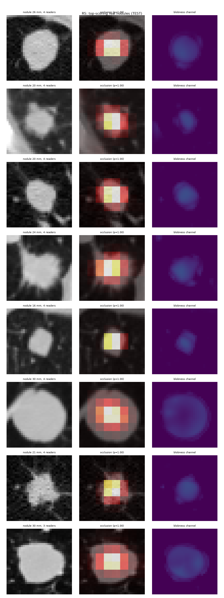
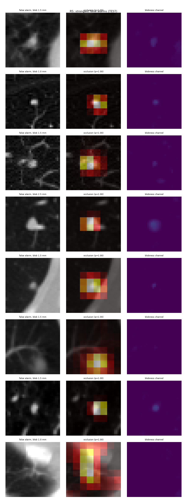
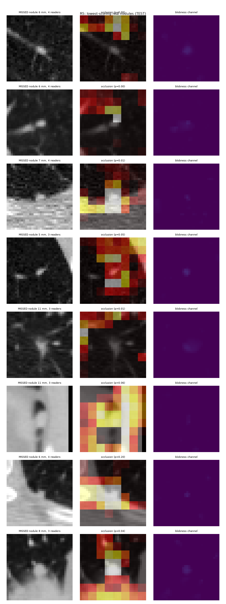

# Phase 4 · explanations on TEST (`scripts/11_explain.py`, R5 seed 42)

Occlusion maps on the **40** top-scoring real nodules (8 mm block of normal lung, stride 4 mm).

| | trained model | random-weights model (sanity check) |
|---|:-:|:-:|
| hottest voxel on the nodule (hit) | **100%** | 0% |
| share of heat on the nodule (concentration) | **0.91** | 0.00 |

- rank correlation trained vs random map: median **-0.06** (near 0 = the map depends on what the model learned → sanity check **PASSED**)

