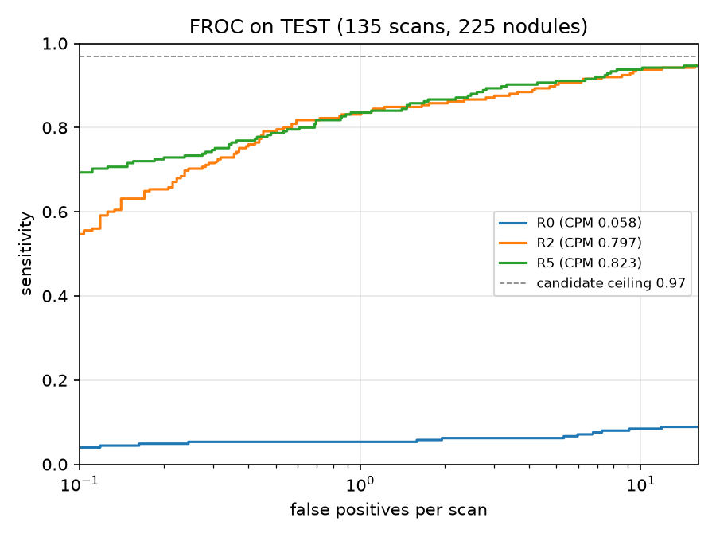

# Phase 4 · TEST results (opened once) (`scripts/10b_test_report.py`)

- TEST: **135** scans, **225** GT nodules, **358784** candidates; candidate ceiling **0.969** (no model can exceed it)
- main model: **R5** (R5 = HUSH); 95% CIs from 1,000 bootstrap resamples of test scans

| model | CPM | 95% CI | sens@0.125 | sens@0.25 | sens@0.5 | sens@1 | sens@2 | sens@4 | sens@8 |
|---|---|---|---|---|---|---|---|---|---|
| R0 | 0.058 | 0.031 – 0.094 | 0.044 | 0.053 | 0.053 | 0.053 | 0.062 | 0.062 | 0.08 |
| R2 | 0.797 | 0.725 – 0.847 | 0.591 | 0.702 | 0.791 | 0.831 | 0.858 | 0.884 | 0.92 |
| R5 | 0.823 | 0.767 – 0.868 | 0.702 | 0.733 | 0.787 | 0.836 | 0.867 | 0.902 | 0.933 |

- **R5 − R2 = +0.026**, 95% CI **+0.001 to +0.078** → a real difference

## R5: recall by nodule size (TEST)

| size | nodules | candidate | found_at_1FP |
|---|---|---|---|
| 3-6 | 27 | 0.889 | 0.63 |
| 6-10 | 107 | 0.963 | 0.85 |
| 10-20 | 68 | 1.0 | 0.897 |
| 20-30 | 18 | 1.0 | 0.889 |
| >30 | 5 | 1.0 | 0.6 |

- `candidate` = found by Phase 2 at all; `found_at_1FP` = still found when the model allows 1 false alarm per scan.

